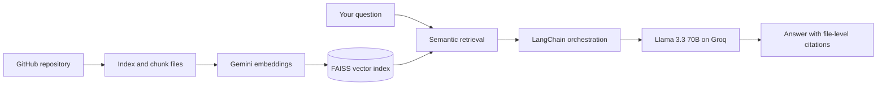

 

---

## 👋 About Me

- 🎓 Third-year **B.Tech Computer Science and Engineering** student (Batch 2028), Kolkata
- 🤖 **Generative AI Intern** at the GenAI Center of Excellence, IEM-UEM Group (May - Jul 2026)
- 🔭 Building **agentic AI workflows**, **RAG applications** and **async FastAPI backends**
- 🌱 Exploring **LoRA / QLoRA fine-tuning**, advanced Generative AI and LLM evaluation
- 💬 Ask me about: RAG, LangChain / LangGraph, FastAPI, system design, DSA
- 💼 **Open to internships:** Software Engineering, Generative AI, AI/ML, Backend and Data Engineering

---

## 🛠️ Tech Stack

**Languages and Databases**

**Backend and Cloud**

**Data and ML**

**Tools**

**Generative AI**

---

## 🚀 Featured Projects

| Project | What it does | Stack | Links |
|---|---|---|---|
| **Sentinel** | Self-healing orchestration layer for distributed agentic AI workflows. Stays available and observable when individual agents fail, with a circuit breaker, health monitoring and event-driven streaming. | Python, FastAPI, LangGraph, async SQLAlchemy, Pydantic | [Live demo](https://sentinel-drab-eight-78.vercel.app) / [GitHub](https://github.com/sapna71/Sentinel) |
| **Codent** | Ask questions about any GitHub repository and get answers grounded and cited to the exact files they came from. | Groq (Llama 3.3 70B), LangChain, Gemini Embeddings, FAISS, FastAPI | [Live demo](https://codent-neon.vercel.app/) / [GitHub](https://github.com/sapna71/Codent) |
| **DigiRaksha** | Backend for a disaster-response platform with real-time SOS alerts and incident reporting. API latency cut by about 30% with async request handling. **HackOasis: Top 4 of 112 teams.** | Python, FastAPI, REST APIs, Authentication | [GitHub](https://github.com/sapna71/Digi-Raksha) |
| **MiniGPT** | End-to-end Generative AI application prototyped during my GenAI CoE internship. | Python, LLMs, RAG | [GitHub](https://github.com/sapna71/miniGPT) |
| **VerifAI** | NLP pipeline that detects logical inconsistencies in long narratives using semantic retrieval and RoBERTa-based NLI. 91.2% accuracy, 89.8% F1-score. | Python, Sentence Transformers, RoBERTa-MNLI | [GitHub](https://github.com/sapna71/VerifAI) |

<b>🔍 How Codent works (click to expand)</b>

---

## 💼 Experience and Highlights

<b>🤖 Generative AI Intern - GenAI Center of Excellence, IEM-UEM Group (May - Jul 2026)</b>

- Contributed to software development with Python backend components and API integration for LLM solutions
- Prototyped MiniGPT, an end-to-end Generative AI application, with LLM and RAG workflows
- Applied prompt engineering and evaluated model outputs, debugging response quality during LLM experiments
- Collaborated with cross-functional teams and contributed to technical workshops and applied research initiatives

<b>🏆 Achievements</b>

- 🥉 **Top 4 of 112 teams** at HackOasis with DigiRaksha
- ⚡ Participated in **7 hackathons**
- 🧩 Solved **100+ DSA problems** on [LeetCode](https://leetcode.com/u/sapnasingh81)

<b>🤝 Leadership and Community</b>

- Core Team Member, Google Developer Group (GDG) on Campus, IEM-UEM
- Student Coordinator, GenAI Center of Excellence, IEM-UEM

---

## 📊 GitHub Stats

## 🧠 LeetCode

---

### 📫 Let's connect

I am looking for **Software Engineering, Generative AI and Backend internships**. If you are building something interesting, I would love to hear about it.

